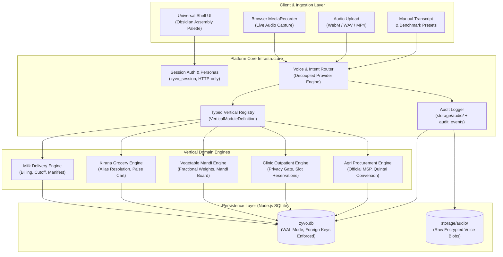
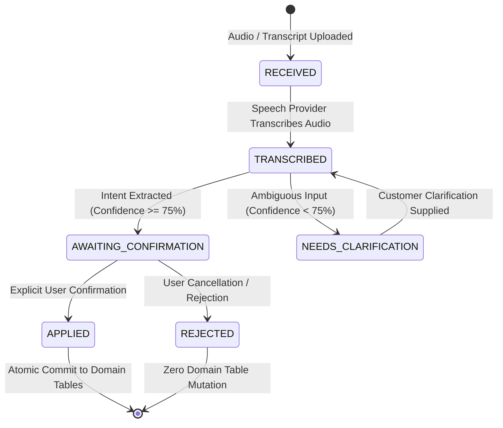
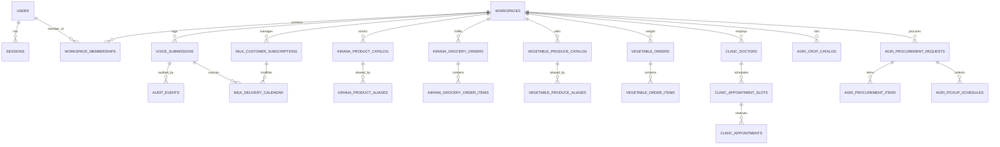

# ZYVO — SYSTEM ARCHITECTURE OVERVIEW
## Modular Monolith Platform for Multilingual Voice Operations

---

### 1. HIGH-LEVEL PLATFORM TOPOLOGY

ZYVO is built as an extensible modular monolith using Next.js 16 (React 19, Turbopack) and Node.js standard-library SQLite (`node:sqlite` `DatabaseSync`).



---

### 2. GENERIC VOICE TRANSACTION LIFECYCLE

Every voice interaction transitions through a 4-stage deterministic lifecycle:



---

### 3. DATABASE RELATIONAL SCHEMA (24 DOMAIN TABLES)

The database schema is organized into shared platform tables and vertical-specific domain tables:



---

### 4. DECOUPLED PROVIDER ARCHITECTURE

ZYVO decouples speech-to-text and intent extraction behind abstract provider registries:

```
src/lib/providers/
├── speech/
│   ├── types.ts                (SpeechToTextProvider interface)
│   ├── provider-registry.ts    (Registry holding sarvam, gemini, groq, mock)
│   ├── provider-router.ts      (Selects provider based on env & network availability)
│   ├── mock.adapter.ts         (Local deterministic benchmark speech adapter)
│   ├── sarvam.adapter.ts       (Sarvam Saaras Indic STT adapter)
│   ├── gemini.adapter.ts       (Google Gemini Audio adapter)
│   └── groq.adapter.ts         (Groq Whisper adapter)
└── intent/
    ├── types.ts                (IntentExtractionProvider interface)
    ├── provider-registry.ts    (Registry holding gemini, groq, deterministic)
    ├── provider-router.ts      (Routing logic for structured slot extraction)
    ├── deterministic.adapter.ts(Local multilingual regex evaluator - Active default)
    ├── gemini.adapter.ts       (Gemini structured JSON mode adapter)
    └── groq.adapter.ts         (Groq LLaMA-3 extractor adapter)
```

**Active Hackathon State:** `EXTERNAL_API_ENABLED=false`. All extractions are handled deterministically via `deterministic.adapter.ts` with zero latency, zero cloud costs, and 100% offline reliability.
